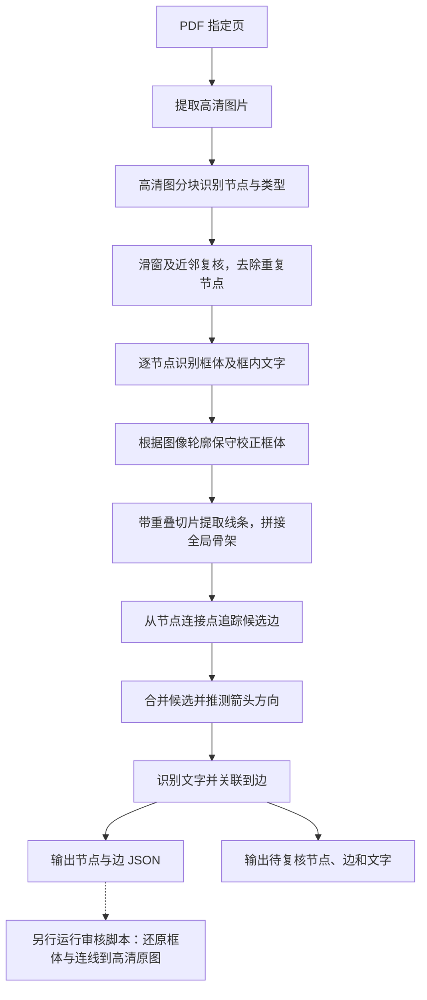

# 高清流程图节点与连线识别

将 PDF 或高清流程图图片转换为包含节点、连线及文字的 JSON，并支持在高清原图上标记结果。

## 流程



节点定位、去重和框体识别调用 `config.json` 中的视觉模型；节点框内文字和边附近文字调用 `ocr` 模型。坐标转换、框体轮廓校正、线条追踪、边方向及文字关联由程序执行。边文字关联基于文字框和路径的距离，归属不明确时保留待复核，不会随意填入某条边。设置 `--no-ocr` 可跳过文字识别。

边识别会尝试校正矩形和菱形框体，并在文字遮挡线条时生成断口连接假设；这类路径会在边证据中标记 `via_gap`。如果节点原类型为 `unknown`，轮廓确认是菱形且已识别的入边和出边关系足够明确，最终图会尝试推断 `merge` 或 `decision`，并在节点的 `type_inference` 中记录依据。原始 `nodes.json` 和 `boxes.json` 保持不变。

## 安装与配置

```bash
python3 -m venv .venv
source .venv/bin/activate
python3 -m pip install -r requirements.txt
cp config.example.json config.json
```

编辑 `config.json`，分别配置 OpenAI 兼容的 `vision` 和 `ocr` 模型地址、模型名和 API Key。配置文件含密钥，请勿提交；也可以使用示例中的环境变量方式配置密钥。

## 使用测试脚本

先激活安装了项目依赖的 Python 环境；脚本使用当前 `PATH` 中的 `python3`。配置好 `config.json` 后运行：

```bash
# 解析高清图片
./test_flowchart.sh 'output/复杂流程图测试/复杂采购流程图_高清.png'

# 解析 PDF 的第 4 页
./test_flowchart.sh 'output/pdf/采购流程解析测试_图片版.pdf' --page 4
```

脚本根据图像尺寸自动选择切片网格，执行完整识别和 OCR，并生成高清审核图。结果默认存入 `runs/` 下的新目录，运行时会显示具体路径。PDF 指定页必须包含嵌入图片；当前程序不能直接处理纯矢量页面。

可以用 `--cols 3 --rows 6` 指定网格，使用 `--output 目录` 指定结果位置；续跑需要使用相同的输入和参数，并带上原来的 `--output 目录 --resume`。使用 `--dry-run` 只检查输入和参数，不调用模型；使用 `--no-ocr` 跳过文字识别。更多选项见 `./test_flowchart.sh --help`。

## 直接运行 Python

```bash
python3 parse_flowchart.py 'output/pdf/采购流程解析测试_图片版.pdf' \
  --page 4 --dpi 300 --output runs/full-flow \
  --locate-nodes --cols 3 --rows 12 --overlap-x 20 --overlap-y 20 \
  --tile-max-size 2000 --dedup-window 2000 --dedup-overlap 25 --with-edges
```

参数含义：`--page` 从 1 开始；`--cols`、`--rows` 设置节点识别网格；`--overlap-x`、`--overlap-y` 是重叠百分比；`--tile-max-size` 限制送入模型的局部图边长。输出目录必须为空或不存在。处理其他 PDF 时，需根据图片尺寸调整网格和局部图尺寸。

中断后使用完全相同的命令加 `--resume`。节点切片、去重复核及框体可复用；边识别已完成且输入及代码未变时会复用，未完成或输入变化时会保留旧目录并创建新的 `edges_retry_...` 目录。

## 输出

对于单张图片，结果在 `runs/full-flow/image_001/`：

- `image.png`：高清原图。
- `nodes.json`：节点 ID、类型和全局中心点。
- `boxes.json`：节点框体及框内 OCR 文字 `text`；`text_status` 区分识别到、未检测到或未请求。`unresolved_candidates.json`、`unresolved_boxes.json` 记录未确定的节点或框体。
- `edges/refined_boxes.json`：边识别前经轮廓保守校正的节点框；`edges/box_refinements.json` 记录校正前后坐标。原始 `boxes.json` 不会被修改。
- `edges/graph.json`：保留节点数据并增加边。每条边包含 `id`、`from`、`to`、`path_global_px`、`text`、`text_status` 和 `text_blocks`；路径点和文字框均为高清全局像素坐标，路径按 `from → to` 排列。`none_detected` 表示没有识别到可归属文字，并不证明原图没有文字。
- `edges/unresolved_edges.json`：有候选但方向、连接或路径未确定的边。
- `edges/unresolved_traces.json`：追踪中断、切片边界待查端点及实体阶段未确认节点。
- `edges/edge_evidence.json`：输出边对应的路径、分叉、推测断口和箭头形状依据。
- `edges/edge_text_review.json`：已关联文字及未定位、归属不明确或疑似注释的文字。

运行目录还会生成 `model_usage.jsonl` 和 `model_usage_summary.json`，分别记录每次实际 HTTP 请求和按模型、阶段汇总的调用与 token 数。自动重试单独计入 HTTP 请求数；缓存复用不计模型调用。用量只取接口返回的 `usage`，缺失时会在报告中标明，不能视为零。`--resume` 会将新的调用追加到同一次任务的用量记录中。

## 单独运行边识别

```bash
python3 edge_extraction.py path/to/image.png path/to/boxes.json \
  --unresolved-nodes path/to/unresolved_candidates.json \
  --output runs/edges
```

默认处理全图。`--tile-size` 和 `--tile-overlap` 分别控制切片核心尺寸和四周重叠像素；也可用 `--region X1 Y1 X2 Y2` 限定处理范围。与 `boxes.json` 同目录的 `unresolved_boxes.json` 会自动读取，其他未确定节点文件可重复传入 `--unresolved-nodes`。使用 `--no-box-refinement` 可跳过轮廓校正。

## 高清图审核

```bash
python3 visualize_graph.py runs/full-flow/image_001/image.png \
  runs/full-flow/image_001/edges/graph.json \
  --evidence runs/full-flow/image_001/edges/edge_evidence.json \
  --box-audit runs/full-flow/image_001/edges/box_refinements.json \
  --output runs/full-flow-review
```

`global_marked.png` 保持原图尺寸：红框为节点，蓝绿色线和箭头为输出的边及方向，橙线表示路径经过推测断口。`box_comparison.png` 中红框是原框、绿框是校正框，只显示有变化的节点。加 `--region X1 Y1 X2 Y2` 可另存该区域的原尺寸裁图。

## 文件

- `parse_flowchart.py`：PDF 图片准备和主流程。
- `entity_extraction.py`：节点分块识别、坐标还原和去重。
- `node_bounding_boxes.py`、`node_box_refinement.py`、`node_geometry.py`：节点框体识别、校正及坐标处理。
- `edge_extraction.py`、`edge_graph.py`、`merge_edge_hypotheses.py`：线条追踪、候选合并及图 JSON。
- `model_client.py`：OpenAI 兼容模型调用。
- `text_extraction.py`：OCR 缓存、文字坐标换算及边文字关联。
- `visualize_graph.py`：高清图标记和框体校正对照。

**输出仍是候选结果。** 节点可能漏检或错框；复杂分叉、交叉、被文字遮挡的线条和箭头方向可能识别错误。当前箭头判断及校正规则针对本测试图调整，其他图像需重新验证。程序会按路径区分同一节点对之间的不同连线，但平行边仍可能遗漏或误合并。请结合未确定结果和标记图审核，不能把输出当作已验证的完整拓扑。
